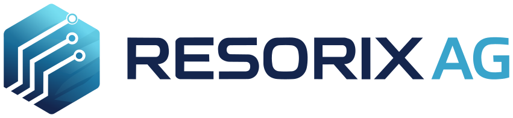
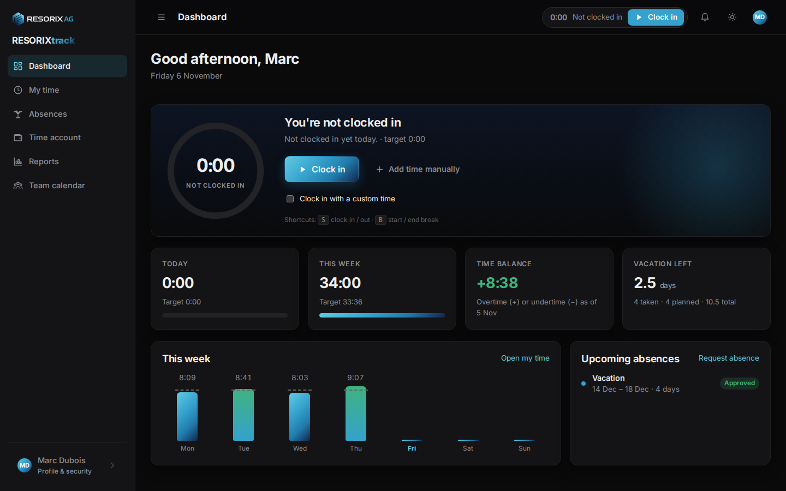
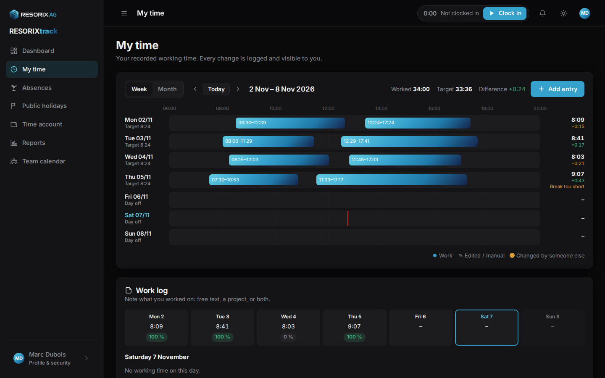
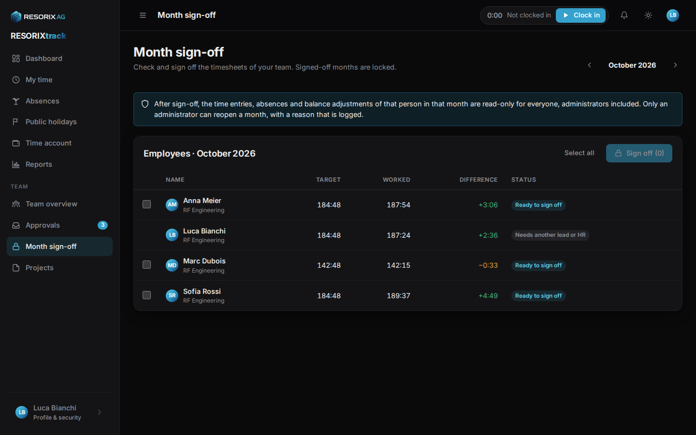
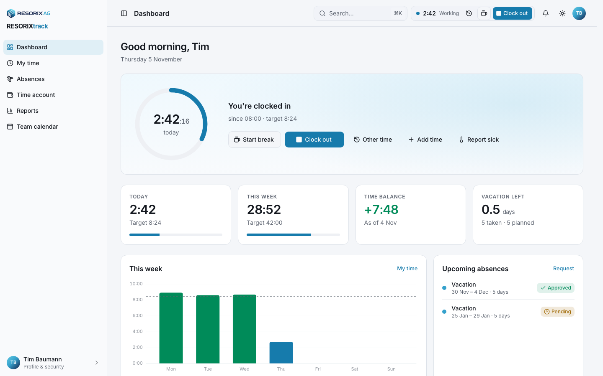
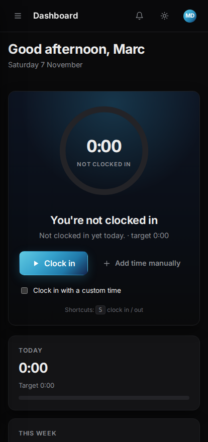

<p align="center"></p>

# RESORIXtrack

**Self-hosted time tracking for small and mid-sized companies.** One click to clock in, transparent time and vacation accounts, a vacation and sick-leave workflow, public-holiday calendars, monthly sign-off, reports – and a complete change history for everything. Developed and maintained by [RESORIX AG](https://resorix.ch), free software under the AGPL-3.0 license (commercial license available), for companies that prefer to keep employee data on their own server.

<p align="center">
  
</p>

| | |
|---|---|
| **Runs on** | Docker Compose · one SQLite file · optional built-in HTTPS (Caddy) |
| **Backend** | Python · Flask · SQLAlchemy · Alembic migrations |
| **Frontend** | Astro + Preact, responsive, installable as a PWA, light and dark theme |
| **Languages** | English, German, French – more can be added as JSON files |
| **API** | REST (`/api/v1`) with OpenAPI docs and scoped personal access tokens |

> **Intended use and disclaimer.** RESORIXtrack is built for **internal hosting on a company network or behind a VPN**. It is not hardened for exposure to the public internet and must not be published there. You deploy and run it **at your own risk**; RESORIX AG accepts no responsibility or liability for any damage, data loss or other consequences arising from the use of this software. See [SECURITY.md](SECURITY.md) and [docs/security.md](docs/security.md).

## Features

**For employees**
- Clock in, start a break, clock out – from every page, with keyboard shortcuts, even when offline (actions are synced later).
- Time account with target hours (from the personal work schedule), worked hours and a running balance.
- Vacation account with yearly entitlement, carry-over and half-days; requests go to the team lead.
- Describe what you worked on (free text and/or projects) – optional, or required with a share of the worked time that your company sets.
- Report sick in one click on a working day; optionally attach a doctor's note.
- Every edit of your own time is possible but logged; corrections by others are highlighted, explained and can be disputed.
- Team calendar: who is out when (sick leave is shown anonymously).

**For team leads**
- Team overview with balances, absences today and this week.
- Approve or decline requests, record absences, correct entries with a reason – the employee is notified.
- Manage the projects of your teams; see logged hours per project and person.
- Sign off a month: it becomes read-only for everyone, including administrators.

**Roles that fit a real company**
- Several administrators, several leads per team, and deputies ("Stellvertreter") with a validity period.
- Administrators manage people, teams, roles and settings but see **no working times**; the HR capability is granted explicitly to those who do.

**For administrators**
- Setup wizard, getting-started checklist, employees, teams, work schedules, public-holiday calendars (import for any country/region, built-in Swiss presets), absence types and working-time rules.
- Branding: your logo and accent colour, used in the app, emails and PDF reports.
- Reports: monthly timesheet (PDF to sign), balances, absences and a raw export (PDF, XLSX, CSV).
- Encrypted backups (Argon2id + ChaCha20-Poly1305 with a mandatory backup password) from the web UI and nightly, audit log and sign-in log.
- Security built in: Argon2id passwords, optional two-factor authentication (TOTP), breached-password check, server-side sessions, CSRF protection, strict Content-Security-Policy, rate limiting, tamper-evident month sign-offs. See [docs/security.md](docs/security.md).
- Data protection: per-person data export (JSON) and anonymisation of former employees after the retention period.

<p align="center">
  
  
</p>
<p align="center">
  
  
</p>

## Quick start

Requirements: a Linux server with Docker 24+ and the Compose plugin, a DNS name pointing at it, and an SMTP account for sending email.

```bash
git clone https://github.com/RESORIX-AG/RESORIXtrack.git resorixtrack   # or download the ZIP from GitHub
cd resorixtrack
cp .env.example .env
python3 -c "import secrets; print(secrets.token_urlsafe(48))"   # paste as SECRET_KEY in .env
# edit .env: SECRET_KEY, BACKUP_PASSWORD (keep both in your password manager), BASE_URL, RESORIXTRACK_DOMAIN, SMTP_*
docker compose --profile tls up -d --build
docker compose logs app | grep -A4 "first-run setup"           # one-time code for the setup wizard
```

Open `https://<your-domain>` and follow the setup wizard: company, working time, public holidays, your administrator account. Then invite your employees from **Administration → Employees**.

The full installation guide, including running behind your own reverse proxy, is in [docs/installation.md](docs/installation.md).

## Documentation

| Guide | For |
|---|---|
| [Installation](docs/installation.md) | Operators: Docker, HTTPS, email, configuration, updates |
| [Administrator guide](docs/admin-guide.md) | Setting up the company step by step; employees, teams, holidays, rules, sign-off, branding |
| [User manual](docs/user-manual.md) | Employees and team leads: daily use |
| [Security](docs/security.md) | How RESORIXtrack protects data, and how to run it securely |
| [Backup & restore](docs/backup-restore.md) | What is backed up, how, and how to get it back |
| [Customizing](docs/customizing.md) | Logo, colours, theme file, languages, email templates |
| [API](docs/api.md) | Tokens, scopes, endpoints, desktop-client behaviour |
| [Development](docs/development.md) | Running locally, tests, demo data, migrations, releases |
| [Licensing](LICENSING.md) | AGPL-3.0, commercial license, contributions |
| [Third-party licenses](docs/third-party-licenses.md) | Licenses of the components RESORIXtrack is built on |

## Development in one minute

```bash
make setup   # Python venv, Node modules, Playwright browser, dev database
make seed    # demo company with three teams and three months of data
make dev     # API on :5000, web app on :4321, Mailpit on :8025
make test    # lint, backend tests, frontend tests, i18n check, build, end-to-end tests
```

Demo accounts and details: [docs/development.md](docs/development.md).

## Project layout

```
backend/resorixtrack/   Flask app: models, services, api/, templates (email, PDF), migrations, CLI, worker
backend/tests/       pytest: unit, API, isolation crawler, migrations, sign-off integrity
frontend/src/        Astro pages, Preact views/components, lib (api, i18n, time), styles/theme.css, i18n/<locale>/
frontend/tests/      vitest unit tests, Playwright end-to-end tests
docker/              Dockerfile, entrypoint, gunicorn config, Caddyfile
scripts/             setup, dev, seed, test, build, smoke, backup, restore, screenshots
docs/                guides and screenshots
```

## Status and support

RESORIXtrack is used in production at RESORIX AG. Bug reports and feature requests are welcome as GitHub issues; security issues go through a private advisory, see [SECURITY.md](SECURITY.md).

## License

[AGPL-3.0-or-later](LICENSE) © RESORIX AG. A commercial license for use outside the AGPL terms is available from mail@resorix.ch – see [LICENSING.md](LICENSING.md).

