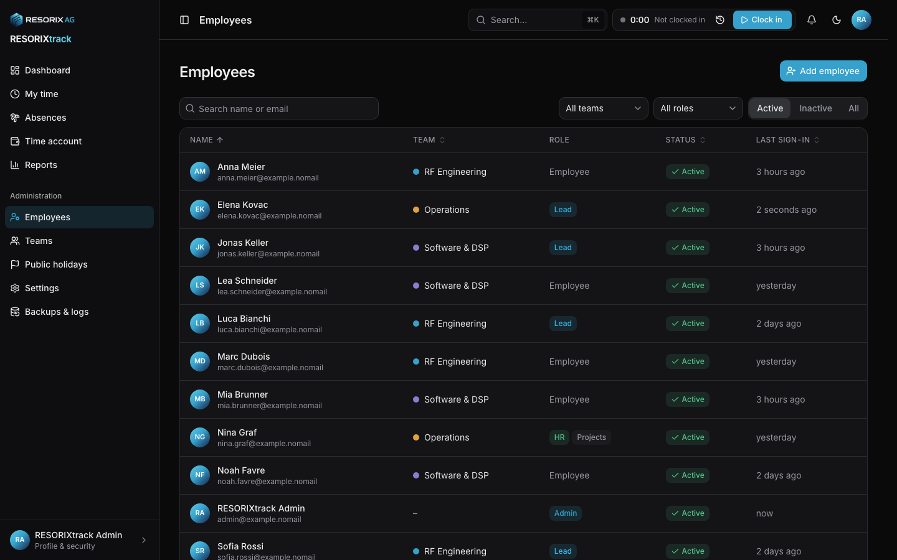
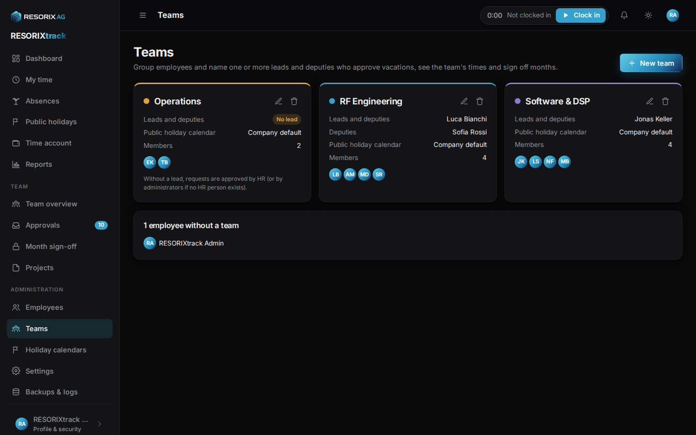
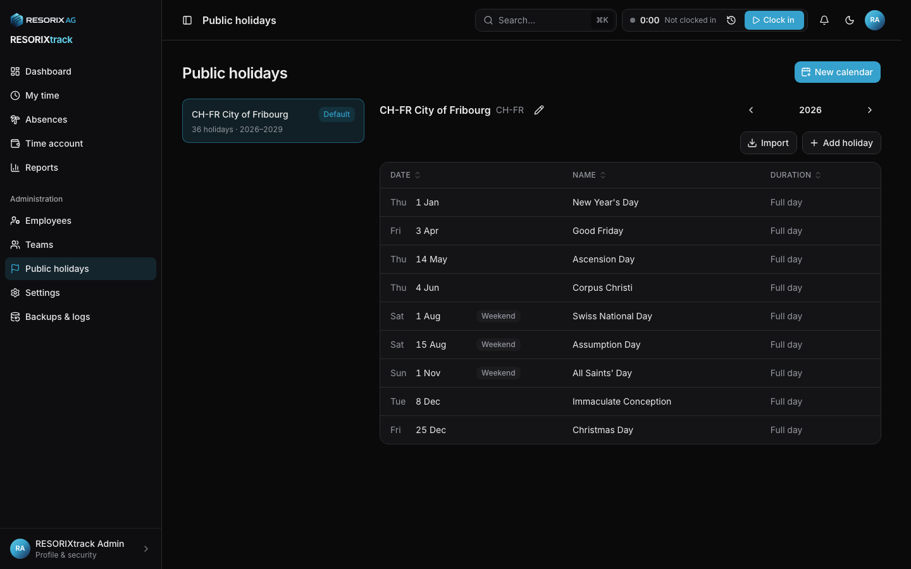
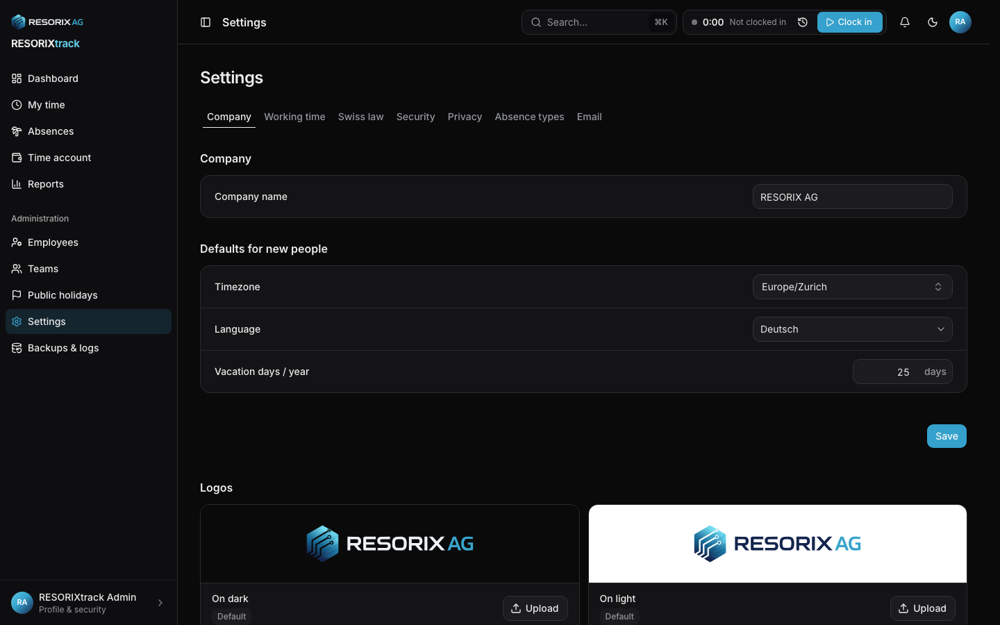
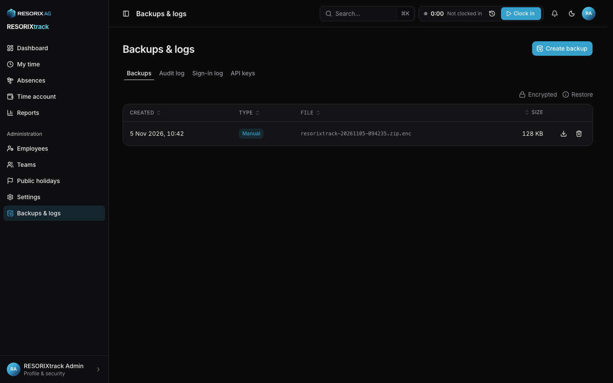

# Administrator guide

For people with the *Administrator* role. Daily use: [user manual](user-manual.md). Installing: [installation.md](installation.md).

## Roles: who sees what

Administrators manage people, teams, settings and backups but see **no working times** of others. Time data is visible to team leads (their members) and to people with the **HR** capability (everyone). The **Projects** capability manages all projects. The first administrator from the setup wizard starts with HR and Projects; remove them once others take over. Details: [security.md](security.md#roles).

## Setting up, step by step

The dashboard shows a **Getting started** checklist (company name, public holidays, teams and leads, people, work schedules, email). Hide it when done.

1. **Working time**: Settings → Working time.
   - *Full-time hours per week*: basis for schedules and pro-rata holidays.
   - *Public holidays*: **Scheduled days** reduces the target only on a person's working day; **Pro rata** credits every Mon to Fri holiday by pensum.
   - *Pro-rate vacation by days per week*: off means you enter each person's own days; on means you enter full-time days and they are scaled.
   - Reason required for past edits, lead permissions (schedules, balances), clock-out reminder after N hours, sick self-report limits.
   - *Work log*: Off, Optional or Required (share of worked time per day, project required). Required blocks sign-off until days are described.
   Changing rules later recalculates all months; signed PDFs keep their figures.
2. **Swiss law**: Settings → Swiss law. *Company is subject to the ArG* (off for e.g. public administrations, agriculture, private households; Art. 2), default weekly maximum 45 or 50 h (Art. 9), night and Sunday work permits (lower those findings to notes), *Sunday/holiday surcharge* (default 50 %, Art. 19) paid as *Payroll* (listed in the timesheet and balances exports) or as *Time credit* (GAV), retention in years (minimum 5). Breaks are always checked when the ArG applies. See [compliance.md](compliance.md).
3. **Email**: configured in `.env`; Settings → Email shows the status and sends a test.
4. **Public holidays**: Administration → Holiday calendars.
   1. *New calendar* → *From preset* (26 cantons, City of Fribourg) or empty. 1 August is marked federal, the preset's other days cantonal.
   2. Preset calendars are topped up automatically: every 1 October (and when the worker starts) the worker adds next year's holidays and notifies administrators. It only adds missing years and never touches signed-off months. Calendars without a preset get a reminder on 1 November if next year is empty. `rt install-holidays --top-up` runs it by hand.
   3. *Import* adds a preset's holidays for one year; importing again adds only missing dates.
   4. *Add* → company days with one click (24 and 31 December afternoon, Berchtoldstag where not cantonal, Sechseläuten and Knabenschiessen afternoon in Zurich) or a custom day. Half days cover the afternoon.
   5. Order of use: person → team → company default. Everyone sees the calendar that applies to them under *Public holidays*.
5. **Teams**: Administration → Teams. Name, colour, holiday calendar, leads and deputies (open-ended or for a period). A team can have several leads; a lead need not be a member. Without a lead, HR decides requests (administrators if nobody has HR).
6. **People**: Administration → Employees → *Add employee*. Name, email, role, team, language, timezone, employment start, pensum, vacation days, legal weekly maximum (45 or 50 h), time recording (full, simplified, waived; see [compliance.md](compliance.md)), *senior executive* (Art. 3 lit. d ArG: no checks), *regular night work* (Art. 17b: 10 % of night work credited as time), optional birth date (minimum vacation). *Send invitation now* emails a link valid 7 days. Then set the work schedule (Schedule tab).
7. **HR and Projects**: grant the capabilities on the person's Profile tab to whoever signs off months, runs company reports or answers data requests.
8. **Projects** (if the work log is on): Team → Projects. Company-wide projects are created by people with the Projects capability, team projects by leads.
9. **Branding**: Settings → Company. See [customizing.md](customizing.md).
10. **Privacy notice**: Settings → Privacy. Shown at `/privacy`, linked from the sign-in page. Fill in [privacy.md](privacy.md) for your records.
11. **Backups**: copy them off the server. See [backup-restore.md](backup-restore.md).

## Month-end routine

1. Early in the month, leads open **Team → Month sign-off** for the previous month.
2. Each person shows target, worked, difference and blockers: month not over, clock running, open requests, work log incomplete.
3. *Sign off* locks the month for everyone: entries, absences, adjustments, work log. The person is notified; the timesheet PDF shows the seal.
4. HR signs off leads and people without a lead, and can sign off all teams at once. Nobody signs off their own month.
5. To correct a signed month, HR *Reopens* it with a reason (logged, notified), corrects, and signs off again.

*Integrity check* on the same page (HR, administrators) verifies seals, chain, data and database guards. The worker also runs it weekly.

## Administration pages

### Employees

Search, filter by team and role. A person's page has tabs:

| Tab | Contents |
|---|---|
| Profile | Contact, role, capabilities, team, contract, recording mode, language, timezone, holiday calendar |
| Schedule | Work schedule versions from a date; past months keep their targets |
| Vacation | Entitlement per year (override a single year) |
| Access | Invitation, set password, two-factor reset, remove passkeys, deactivate, data export (HR), anonymise |
| History | Change log of the person's records |

- **Deactivate**: signs out everywhere, stops the clock, removes lead roles, API keys and passkeys. Data stays; reactivation is possible.
- **Export** (HR only): everything stored about the person as JSON.
- **Anonymise**: only for deactivated people with an employment end, after `employment end + retention years`. Removes name, email, personal fields, documents, credentials, logs; time records stay without identity.
- **Offboarding**: set the employment end, sign off the last month, settle the balance (Time account → Adjust balance), download the final timesheet, deactivate; anonymise after the retention period.

### Teams

Leads and deputies with periods, members, holiday calendar. Deleting a team keeps its members' data; they have no team afterwards.

### Holiday calendars

See step 4. Deleting a calendar in use makes teams and people fall back to the next one.

### Settings

| Tab | Contents |
|---|---|
| Company | Name, defaults for new people, logos, accent colour |
| Working time | Hours and holidays, corrections and leads, sick reports, work log |
| Swiss law | Checks, permits, retention |
| Security | Two-factor required for administrators or everyone, API keys on or off, sign-in log retention (session lengths: `.env`) |
| Privacy | Privacy notice text |
| Absence types | Which types need approval, allow documents, reduce the target or use the balance, deduct vacation; custom types |
| Email | SMTP status, test email |

### Backups and logs

- **Backups**: create, download, delete. Restore runs on the server: [backup-restore.md](backup-restore.md).
- **Audit log**: every change with who, when, before, after and why; filter by person, record and action. Older
  entries load as you scroll.
- **Sign-in log**: every attempt with result, IP and device; older attempts load as you scroll.
- **API keys**: every key with owner, scopes, last use and expiry; revoke one with a reason (the owner is notified).

### Reports

Administrators without HR see no time reports. HR sees everyone; leads see their teams. Kinds: timesheet, balances, absences, projects, time entries, labour law; PDF, XLSX, CSV.

## Server commands

See the CLI table in [installation.md](installation.md#cli).

## FAQ

| Question | Answer |
|---|---|
| A balance is far off | Check employment start, schedule versions (gaps), holiday calendar, manual adjustments. |
| Someone forgot to clock out | The dashboard warns them; they clock out and correct the end time with a reason. |
| Change a signed month | HR reopens it (logged, notified). |
| Lost phone and backup codes | Access tab → Reset two-factor. |
| No email server | Access tab → Set password; hand it over in person. |
| API access for a desktop app | The person creates an API key under Profile. See [api.md](api.md). |
