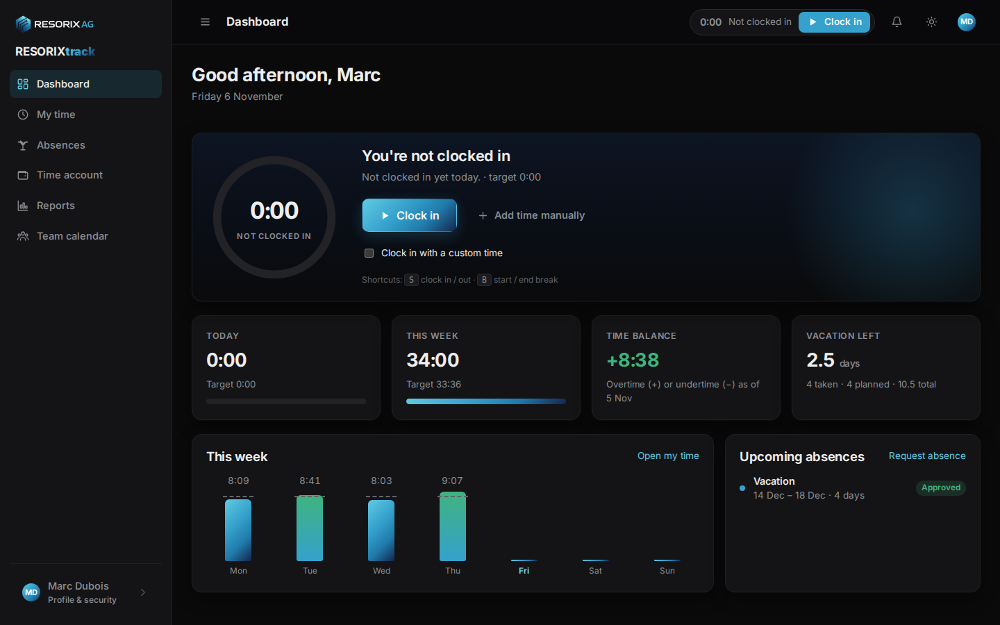
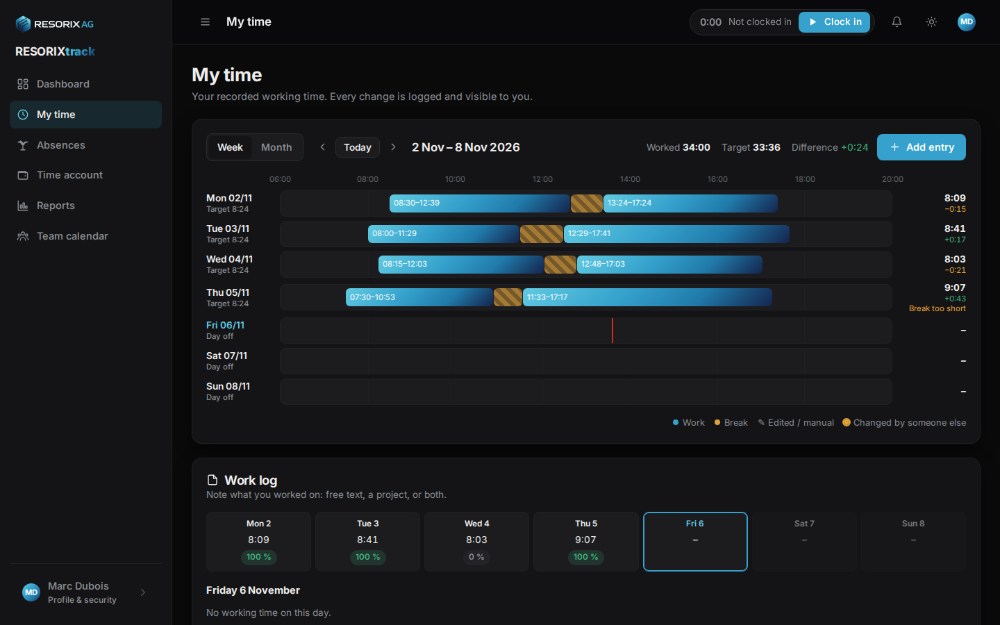
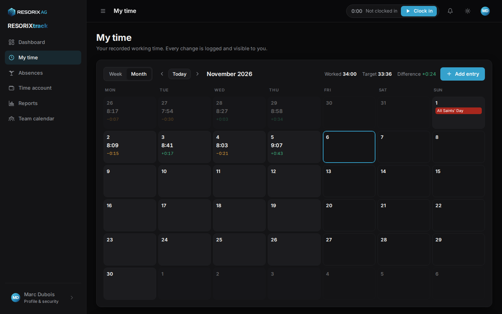
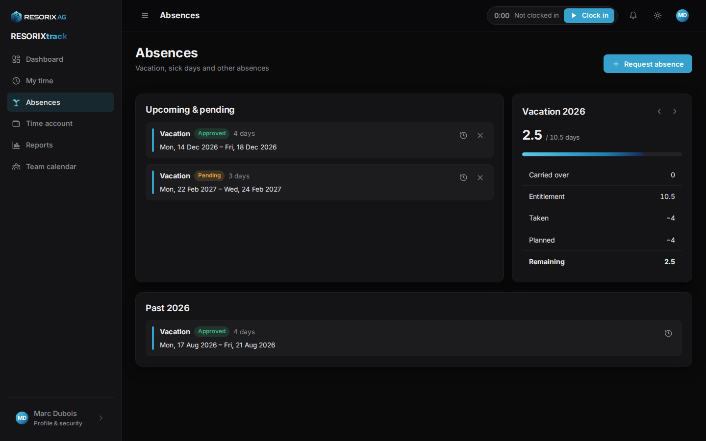
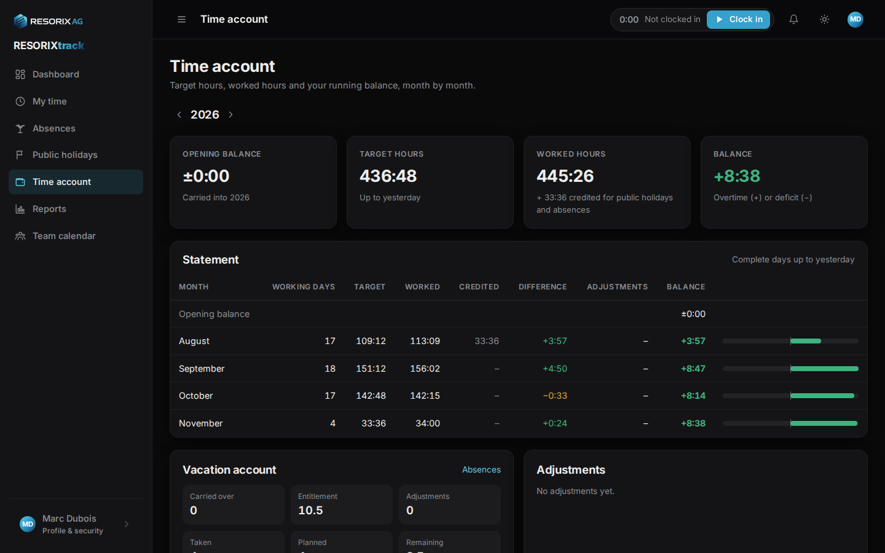
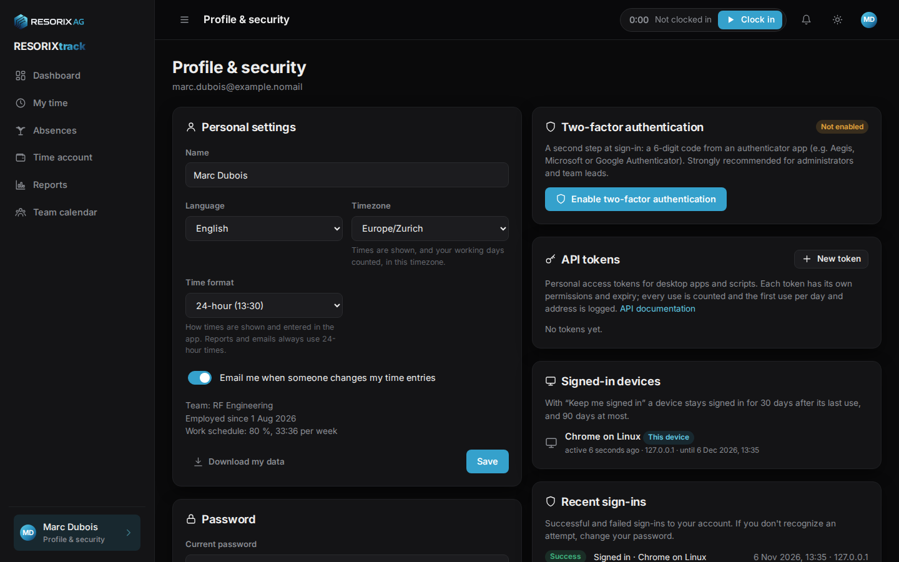
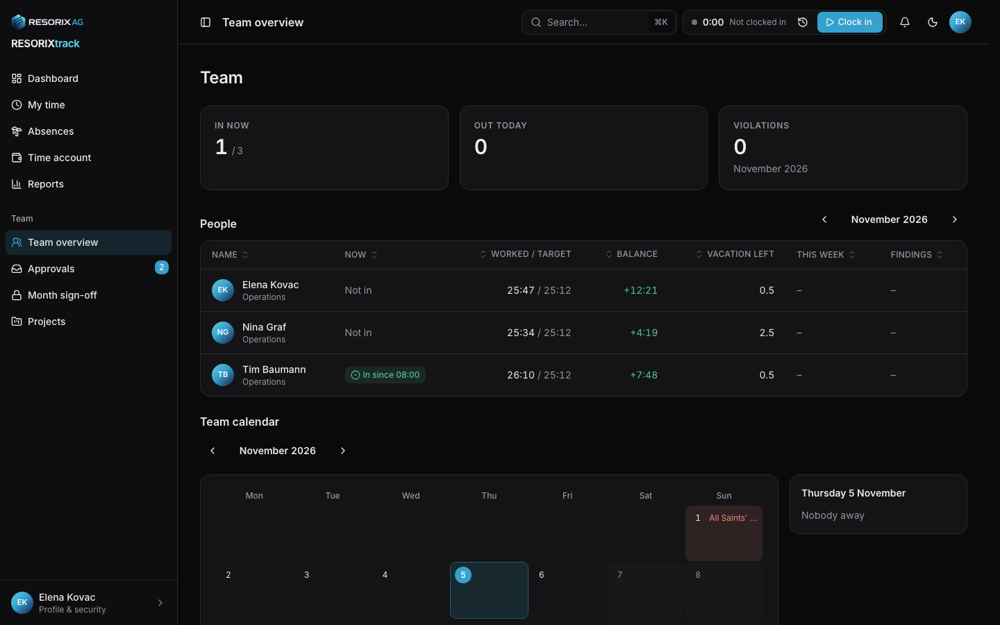
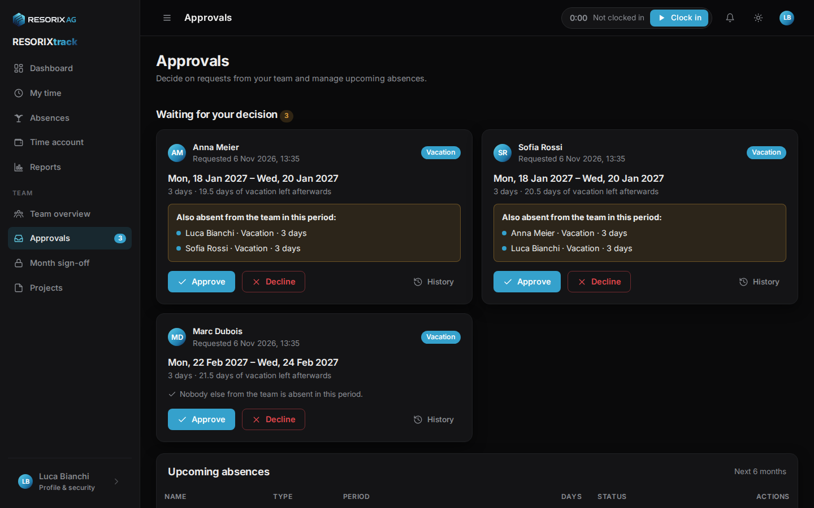
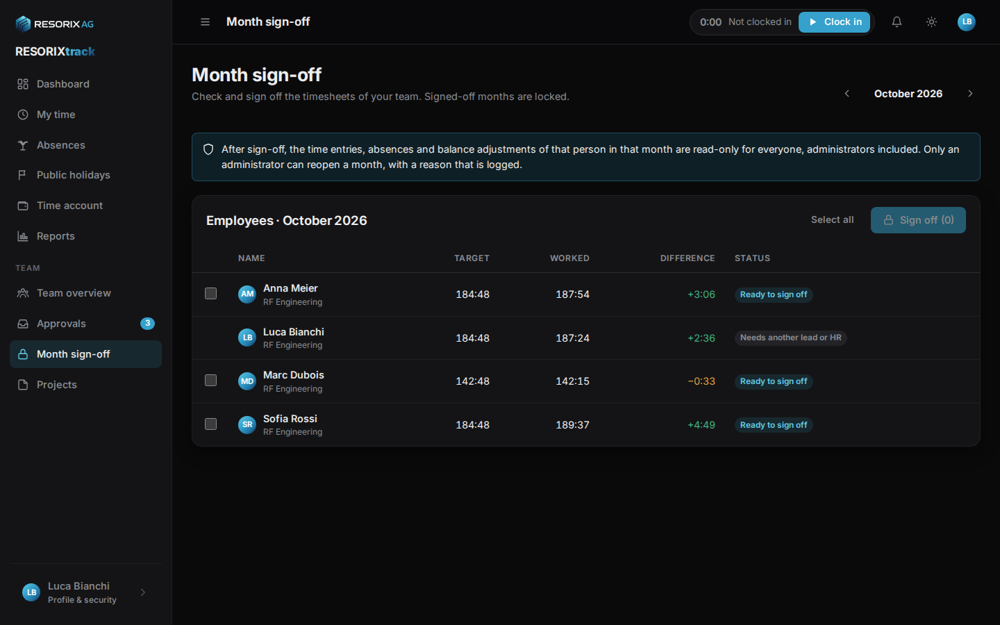
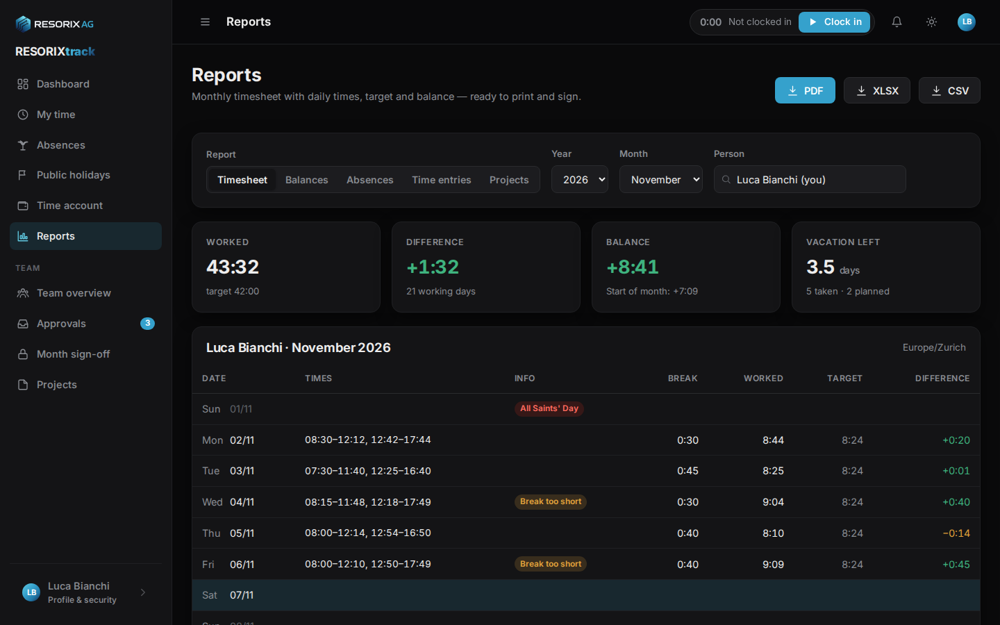

# User manual

For everyone who records their time in RESORIXtrack, plus a section for team leads. Administrators: see the [administrator guide](admin-guide.md).

## Getting in

- You receive an **invitation email**. The link is valid for 72 hours; it lets you choose your language, timezone and password. If it expired, use *Forgot password?* on the sign-in page to get a new link, or ask your administrator.
- **Keep me signed in on this device** keeps you signed in for a month after your last visit (90 days at most). Don't use it on shared computers.
- **Forgot password?** sends a link valid for one hour. If your company has no email set up, the page tells you to contact an administrator instead.
- The app works on phones too, and can be installed from the browser menu ("Add to home screen").

## Dashboard

The dashboard shows your clock, today's and this week's hours against your target, your **time balance** (overtime + / undertime −) and the **vacation left** this year, plus upcoming absences.

### Clocking

- **Clock in** when you start working, **Start break** / **End break** around breaks, **Clock out** when you leave. The buttons are also in the top bar on every page.
- Keyboard: **S** clocks in/out, **B** starts/ends a break (when no text field is focused).
- Offline? The click is stored and synced with its original time as soon as you are back online.
- Forgot to clock in? **Add time manually** opens the entry editor.
- Forgot to clock out? The next morning the dashboard warns you: clock out, then correct the end time of yesterday's entry under *My time* (a reason is required for past days). After a configurable number of hours you also get an email reminder.

Forgot to clock in? Tick **Clock in with a custom time** under the button and enter when you really started (today, up to 48 hours back). The entry is marked as manual, like a corrected one.

### Report sick

**Report sick** records today as a sick day and informs your team lead. It is available on working days that aren't public holidays or vacation days. You can attach a doctor's note afterwards under *Absences* (optional, unless your company requires it).

## My time

Your recorded time, as a **week** timeline or a **month** grid. Each day shows worked and target hours and the difference.

- **Add entry** (or click into an empty part of a day in the week view): type (work or break), date, start and end, optional note.
- **Edit** an entry by clicking it. Changes to **today** need no reason. Changes to **past days** need a reason, which is stored in the change history – this keeps everyone's records trustworthy. Deleting works the same way; deleted entries stay in the history.
- Entries marked **Edited / manual** were entered or changed by hand. Entries marked **Changed by someone else** were corrected by your team lead or an administrator; open the history to see what changed and why, and use **Dispute this change** if you disagree – the person who made the change is notified.
- A **signed-off month** is read-only and shows a lock. Ask your team lead or an administrator if something needs to be corrected; they can reopen the month.
- **Break too short** warnings follow the legal minimum breaks; they are hints, not blocks.

Times are shown in your timezone (Profile). Entries are stored in UTC, so travelling never changes what you worked.

## Work log – what did you do?

If your company has switched the work log on, you describe what you worked on: as free text, by picking a **project** or typing a **customer reference** (free text such as a customer number; recent ones are suggested), or both. Each item has a duration – either entered directly or as exact *from – to* times, from which the duration follows (timed items of a day cannot overlap); the bar shows how much of the day's worked time is described.

- On the dashboard, **What did you do today?** lets you add items for today; the week view under *My time* has a **Work log** card with one chip per day – click a day to see and edit its items.
- Projects are set up by your team lead or administrator; "No project" is always available unless your company requires a project or customer reference. A customer reference replaces the project for that item. Free text can always be added, with or without either.
- When the work log is **required**, every day must describe at least the configured share of its worked time (e.g. 80 %). Days below it show an orange flag, you are reminded after clocking out, and the month can't be signed off until the gap is closed. Today is never flagged.
- Every item is part of the change history, like time entries.

## Absences

Vacation, sick leave and other absences, with your **vacation account** for the year: entitlement, carried over, taken, planned, remaining.

- Your yearly entitlement is set by your administrator; depending on the company settings it is either entered as your own days or scaled from a full-time value by the number of days you work per week.
- **Request absence**: type, first and last day, duration (full day, morning, afternoon; or first day afternoon only / last day morning only for longer periods), optional note. The preview shows how many working days it uses and how much vacation is left afterwards. Weekends and public holidays are never deducted.
- Vacation (and other types marked "requires approval") goes to your **team lead**, or to an administrator if your team has no lead. You are notified of the decision in the app and by email.
- **Sick leave** is recorded immediately; your lead is informed. You can attach documents (PDF, JPG, PNG, HEIC) that only you, your lead and administrators can see.
- **Cancel** a pending request any time; approved absences in the past can only be cancelled by your lead.
- Your lead or an administrator can also record absences for you; you are notified and see who did it.

## Time account

Month by month: target, worked, credited (public holidays and absences), difference and the running balance, plus the list of manual adjustments (opening balance, payouts, corrections) with their reasons. The balance counts complete days up to yesterday; today is shown live on the dashboard.

## Team calendar

Shows who in your team is absent when. Colleagues' sick leave appears only as "Absent"; notes are never shown. Team leads see all of their teams.

## Reports

Your monthly **timesheet** as PDF (to print and sign), XLSX or CSV. Team leads and administrators have more reports.

## Profile & security

Open it from your name at the bottom of the sidebar or from the avatar menu at the top right (which also links straight to two-factor authentication and API tokens).

- **Language** (English, German, French) and **timezone**.
- **Password**: changing it signs out all your other devices and revokes your API tokens. An email confirms the change. New passwords that appear in known data breaches are refused.
- **Two-factor authentication**: strongly recommended for team leads and administrators; your company may require it for administrators or for everyone (you then see a reminder until it is on). *Enable* → confirm your password → scan the QR code with an authenticator app (Aegis, Microsoft Authenticator, Google Authenticator, 1Password, …) → enter the code → **save the eight recovery codes** somewhere safe. From then on, sign-in asks for the 6-digit code after the password; a recovery code works once if you lose the phone. Lost both? An administrator can reset it for you.
- **Time format**: 24-hour (default) or 12-hour, for everything shown and typed in the app. Reports and emails always use 24-hour times.
- **Download my data**: a JSON file with everything RESORIXtrack stores about you.
- **Signed-in devices**: see where you are signed in and sign out any device.
- **Recent sign-ins**: successful and failed attempts on your account. If you don't recognise one, change your password.
- **API tokens**: for desktop apps and scripts; see [api.md](api.md).
- **Email me when someone changes my time entries**: on by default.

## Notifications

The bell in the top bar shows decisions on your requests, corrections to your entries, sign-offs and reminders. Most of them are also sent by email.

---

## For team leads

Team leads – and deputies while their period is current – see the **Team** section in the navigation. People with the HR capability see it for the whole company.

### Deputies

On the **Team overview**, name a deputy ("Stellvertreter") for your team: for a period (your vacation) or open-ended. The deputy has the same powers as you while the period is current – approvals, corrections, sign-off, team projects – and is notified. Remove a deputy any time. Administrators can also assign additional leads.

### Team overview

The team calendar for the month, who is out today and this week, and the **time balances** of the month (target, worked, difference, balance, vacation left, pending vacation). Click a person to open their page.

### Approvals

Requests waiting for your decision, with the person's remaining vacation and who else in the team is absent in that period. **Approve** or **Decline** with an optional note; the employee is notified by email. Below, upcoming absences of your teams, which you can cancel with a reason.

### Projects

**Team → Projects**: create and edit the projects of your teams (name, code of up to 30 characters, colour, description), and deactivate ones that are finished – inactive projects stay on past items and in reports but can't be selected for new ones. Company-wide projects (available to everyone) are managed by administrators.

### A member's page

From the team overview: the person's **time** (same views as "My time", but you can add, edit and delete entries – a reason is always required and the employee is notified and can dispute), **absences** (record vacation, mark sick, attach documents), **time account** (adjust the balance or the vacation entitlement, if the administrator allowed it), **work schedule** (new versions from a date, if allowed) and the complete **change history**.

### Month sign-off

At the start of each month, check the previous month for every member: target, worked, difference. If something is wrong, correct it first (reason required). Then select the people and **Sign off**. A sign-off is blocked while a clock is still running, a request is undecided, the month isn't over yet, or – when the work log is required – a day is below the required share (ask the person to complete it, or add items for them on their page).

After sign-off the month is read-only for everyone, including administrators. Your own month is signed off by another lead of your team or by HR. If a correction is needed later, HR reopens the month with a reason; you sign it off again afterwards.

### Reports

Timesheets for each member (including their work log), balances of your teams, the absences overview, the **projects** report (logged hours per project and person) and the raw time-entries export – as PDF, XLSX or CSV.
